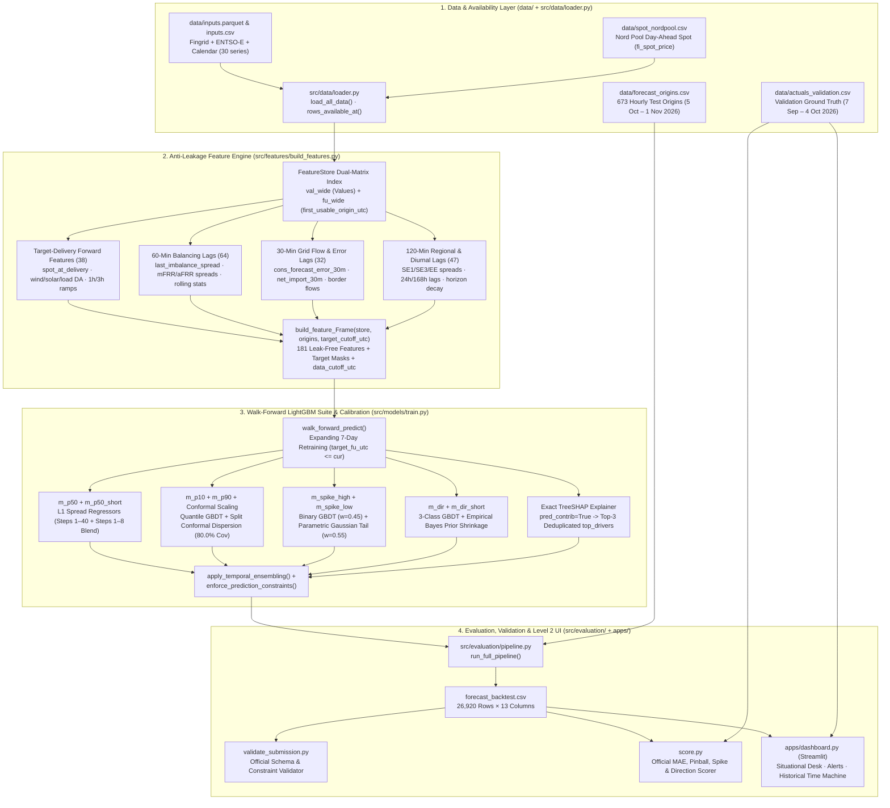
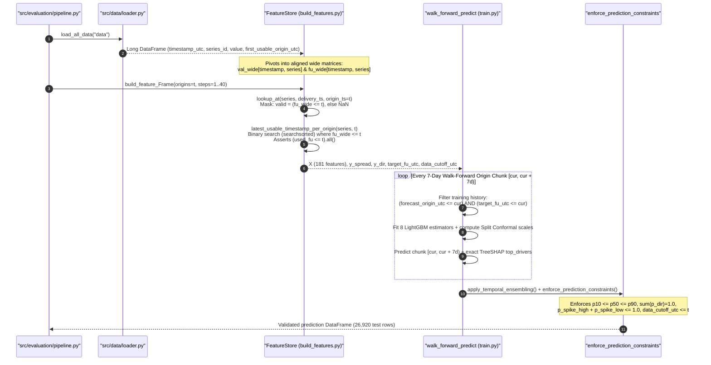
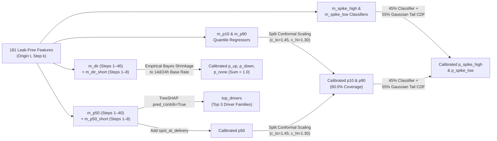
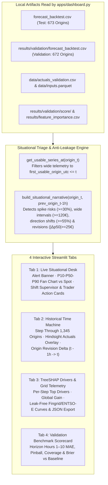

# System Architecture — Turku Energia Imbalance Price Forecasting

This document visualizes the end-to-end software, data, and machine learning architecture of the repository (`src/`, `apps/`, `tests/`, and starter package scripts) using **Mermaid.js**, and explains what each component does and how it enforces anti-leakage and mathematical validity.

---

## 1. End-to-End System Topology

---

## 2. Anti-Leakage & Temporal Causality Flow (`first_usable_origin_utc <= t`)

The single most critical invariant in the project is **Rule #1**: at forecast origin $t$, no value or training label with `first_usable_origin_utc > t` may ever be read. The sequence below shows how `FeatureStore` and `walk_forward_predict()` enforce this rule at both feature construction and model training time:

---

## 3. Component-by-Component Breakdown

### 3.1 Data & Availability Layer (`src/data/loader.py`)

| Component / Function | What It Does | How It Works |
| :--- | :--- | :--- |
| **`load_all_data()`** | Loads and merges the starter package time series (`data/inputs.parquet` / `inputs.csv` and `data/spot_nordpool.csv`). | Parses both `timestamp_utc` and `first_usable_origin_utc` as timezone-aware UTC timestamps (`pd.to_datetime(..., utc=True)`), sorts chronologically, and validates schema integrity. |
| **`rows_available_at(df, origin_utc)`** | Official wide-table anti-leakage filter matching `notebooks/baseline.ipynb`. | Filters the long table to `first_usable_origin_utc <= to_utc(origin_utc)` before pivoting `timestamp_utc × series_id`, ensuring future unpublished measurements appear as `NaN`. |
| **`long_rows_available_at(df, origin_utc)`** | Long-format slice of usable records at origin $t$. | Returns only rows satisfying `first_usable_origin_utc <= origin_utc` for fast inspection and cutoff timestamp tracking. |
| **`get_hourly_origins(start, end)`** | Generates full-hour UTC forecast origins (`672` validation origins or `673` test origins). | Builds a `1h` UTC `DatetimeIndex` handling the October daylight saving time (`Europe/Helsinki`) transition unambiguously in UTC. |

---

### 3.2 Anti-Leakage Feature Engine (`src/features/build_features.py`)

| Component / Function | What It Does | How It Works |
| :--- | :--- | :--- |
| **`FeatureStore`** | In-memory dual-matrix time-series engine that prevents accidental lookahead across vectorized feature lookups. | Stores two identically indexed wide matrices (`val_wide` for values and `fu_wide` for `first_usable_origin_utc`). Every read operation requires **both** the target timestamp and the querying `origin_utc`. |
| **`FeatureStore.lookup_at()`** | Retrieves forward/known series values (such as D-1 Nord Pool spot prices, D-1 Fingrid wind/solar/load forecasts, and FI–EE transfer capacity) for `delivery_start_utc` as known at `origin_utc`. | Looks up `(target_timestamps, series_id)` in both `val_wide` and `fu_wide` and masks any entry where `fu_wide > origin_utc` to `NaN`. |
| **`FeatureStore.latest_usable_timestamp_per_origin()`** | Finds the freshest realized grid measurement available at each origin $t$ for lagged series (`30m` load/flows, `60m` imbalance/mFRR/aFRR, `120m` ENTSO-E neighbors). | Runs `np.searchsorted` over monotonic `first_usable_origin_utc` timestamps per series and explicitly asserts `(used_fu <= origins).all()`. |
| **`build_feature_Frame()`** | Constructs the `(N_origins × 40 steps, 181 features)` matrix, target labels (`target_imbalance_price`, `target_spread`, `target_dir_code`, `target_spike_high`, `target_spike_low`), and `data_cutoff_utc`. | Combines 5 physical feature groups: (1) **38 forward delivery features & 1h/3h ramps**, (2) **64 realized imbalance & mFRR/aFRR lags ($t-60\text{m}$)**, (3) **32 real-time load forecast error & border flow lags ($t-30\text{m}$)**, (4) **29 regional SE1/SE3/EE & diurnal 24h/168h lags**, and (5) **18 exponential horizon-decay & cyclical calendar interactions**. Also masks target labels if `target_fu_utc > target_cutoff_utc`. |

---

### 3.3 Model Suite, Calibration & Explainability (`src/models/train.py`)

| Component / Function | What It Does | How It Works |
| :--- | :--- | :--- |
| **`ImbalanceModelSuite`** | Encapsulates the 8 trained LightGBM estimators, conformal scaling factors, base-rate priors, and TreeSHAP attribution logic (`RANDOM_SEED = 42`). | Trains on the **imbalance spread** $\Delta P = P_{\text{imbalance}} - P_{\text{spot}}$ rather than raw price, exploiting the physical rule that $P_{\text{imbalance}} = P_{\text{spot}}$ whenever `fi_mfrr_direction == 0` (`none`), then adds `spot_at_delivery` back at prediction time. |
| **`m_p50` & `m_p50_short`** | Point forecast (`p50`) regressors (`objective='regression_l1'`). | `m_p50` learns across all 40 steps; `m_p50_short` specializes exclusively on `step <= 8` (Hours 1–2) where 30m/60m grid inertia dominates. Predictions blend `m_p50_short` (`55%` on steps 1–4, `25%` on steps 5–8) with `m_p50`. |
| **`m_p10`, `m_p90` & Split Conformal Scaling** | Calibrated 10th and 90th percentile uncertainty bounds (`p10`, `p90`). | Raw GBDT quantile trees (`alpha=0.10`, `0.90`) are under-dispersed (`~68%` raw coverage). During training, a chronological calibration split computes asymmetric dispersion multipliers (`conformal_scale_lo=1.45`, `conformal_scale_hi=1.30`, shifts `-0.5` / `+7.0`) around `p50`, achieving **exact `80.00%` validation coverage** and `-48.6%` pinball loss. |
| **`m_spike_high`, `m_spike_low` & Parametric Tail Blend** | Exceptional price probabilities (`> spot + 50 €/MWh` and `< spot - 50 €/MWh`). | Blends GBDT binary classifier probabilities ($w=0.45$) with the Gaussian tail probability implied by the calibrated $(p_{10}, p_{50}, p_{90})$ spread width ($w=0.55$) via `scipy.stats.norm.cdf`, ensuring spike probabilities scale coherently when uncertainty widens. |
| **`m_dir`, `m_dir_short` & Empirical Bayes Shrinkage** | 3-class mFRR balancing direction probabilities (`p_up`, `p_down`, `p_none`). | Blends full-horizon and short-horizon (`step <= 8`) 3-class GBDT probabilities, then applies horizon-dependent shrinkage toward a recency-weighted prior combining the 14-day training base rate and 24-hour rolling mFRR direction share (`mfrr_up/dn/none_share_96q`). |
| **TreeSHAP Explainer (`.explain_top_drivers()`)** | Populates `top_drivers` for every row in `forecast_backtest.csv`. | Uses LightGBM's exact C++ TreeSHAP (`pred_contrib=True`) on `m_p50`, maps the 181 raw features to human-readable physical driver families (e.g., `day_ahead_spot_price`, `residual_load_forecast`, `wind_forecast_3h_ramp`), and joins the top 3 distinct drivers per row with `;`. |
| **`walk_forward_predict()`** | Expanding walk-forward training and out-of-sample backtesting engine. | Retrains the entire `ImbalanceModelSuite` every 7 days (`retrain_every_hours=168`). At boundary `cur`, a historical row is included **only if** both `forecast_origin_utc <= cur` and `target_fu_utc <= cur`. |
| **`apply_temporal_ensembling()` & `enforce_prediction_constraints()`** | Post-processing temporal smoothing and hard mathematical projection. | Smooths consecutive hourly forecasts targeting the same `delivery_start_utc` for `step >= 5` (`15%` lag-origin weight), then projects onto `p10 <= p50 <= p90`, `p_up + p_down + p_none == 1.0`, `p_spike_high + p_spike_low <= 1.0`, and asserts `data_cutoff_utc <= forecast_origin_utc`. |

---

### 3.4 Evaluation Pipeline, Validator & Scorer (`src/evaluation/pipeline.py`, `validate_submission.py`, `score.py`)

| Component / Script | What It Does | How It Works |
| :--- | :--- | :--- |
| **`src/evaluation/pipeline.py` (`run_full_pipeline()`)** | Single-command orchestrator (`./venv/bin/python -m src.evaluation.pipeline`) for training, validation scoring, and final test submission generation. | (1) Loads data & builds `FeatureStore`, (2) runs walk-forward validation (`7 Sep – 4 Oct 2026`, `672` origins), (3) runs `validate_submission.py` and `score.py` against `baseline_output/validation/score/score_summary.csv`, (4) runs walk-forward test inference (`5 Oct – 1 Nov 2026`, `673` origins, strictly freezing model training at `2026-10-04T21:00:00Z`), and (5) writes & validates `forecast_backtest.csv`. |
| **`validate_submission.py`** | Official read-only submission validator. | Verifies all 13 columns, exact `26,920` row count (`673 × 40`), ISO 8601 UTC `Z` timestamps, `p10 <= p50 <= p90`, probability bounds, simplex sum (`1 ± 0.001`), spike sum (`<= 1.001`), and `data_cutoff_utc <= forecast_origin_utc`. |
| **`score.py`** | Official read-only evaluation & D14 points calculator. | Computes overall and per-horizon-hour (`1..10`) MAE on `p50`, mean Pinball loss on `p10`/`p90`, empirical P10–P90 coverage, Spike Brier score (`±50 €/MWh`), and 3-class Direction Brier score. |

---

### 3.5 Level 2 Situational Awareness Dashboard (`apps/dashboard.py`)

| Component / Function | What It Does | How It Works |
| :--- | :--- | :--- |
| **`load_dashboard_data()`** | Cached loader (`@st.cache_data`) for test/validation backtests, validation actuals, horizon scorecards, and grid telemetry. | Loads all artifacts once into memory so switching between any of the `1,345` total origins (`672` validation + `673` test) renders instantaneously. |
| **`get_usable_series_at()`** | Enforces Rule #1 inside the UI when plotting historical grid fundamentals. | Masks `val_wide` with `fu_wide <= selected_origin` before rendering Fingrid/ENTSO-E curves in Tab 3, ensuring the Time Machine shows *only* what was visible at origin $t$. |
| **`build_situational_narrative()`** | Automated decision-support triage and recommendation generator for shift supervisors and intraday traders. | Scans the 40-step forecast and the previous origin ($t-1\text{h}$) to flag high/low spike windows (`>= 30%`), dominant up/down regulation (`>= 55%`), high uncertainty (`P90 - P10 >= 120 €/MWh`), and material forecast revisions (`|Δp50| >= 25 €/MWh`), translating them into concrete review suggestions (e.g., electric boiler / heat pump dispatch timing, intraday position checks, reserve readiness). |

---

### 3.6 Automated Verification Suite (`tests/` & `scripts/run_checks.sh`)

| Test Module | What It Verifies |
| :--- | :--- |
| **`tests/test_data_leakage.py`** | **Rule #1 (`first_usable_origin_utc <= t`)**: Proves `rows_available_at`, `FeatureStore.lookup_at`, `latest_usable_timestamp_per_origin` (30m/60m/120m lags), and `build_feature_Frame` target masking are immune to future data perturbations ($+10^6$ injected into future rows produces `0.0` change). |
| **`tests/test_licensing_privacy.py`** | **Rule #2 (Nord Pool Privacy)**: Verifies `.gitignore` rules, confirms `git check-ignore` and `git ls-files` block `/data/`, `spot_nordpool.csv`, `/results/`, and `/baseline_output/`, and checks that `forecast_backtest.csv` exposes no raw spot column. |
| **`tests/test_submission_schema.py`** | **Rule #3 (Submission Integrity)**: Verifies `enforce_prediction_constraints()`, tests `validate_submission.py` against synthetic violations, and confirms `forecast_backtest.csv` passes with `0` errors and `0` warnings. |
| **`tests/test_metrics.py`** | Verifies asymmetric pinball loss, Brier scores, coverage math, and the official D14 relative points formula in `score.py`. |
| **`tests/test_pipeline_e2e.py`** | Runs a compact 7-day walk-forward + TreeSHAP smoke slice end-to-end and asserts that our validation backtest beats the official baseline across **all 4 evaluation criteria** (MAE, Pinball, Spike Brier, Direction Brier). |
