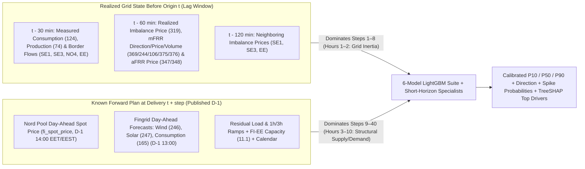

# Evaluation Report — Turku Energia Imbalance Price Forecasting Challenge
**Event:** Since AI Hackathon 2026 (6–8 Nov 2026, Turku)  
**Schema Version:** `1.0` | **Scorer Version:** `0.1.1` | **Validator Version:** `0.1.0`

---

## 1. Executive Summary

To support operational decision-making for Turku Energia's production shift supervisors and electricity traders, we built an end-to-end probabilistic forecasting and situational awareness system covering the 10-hour (40 quarter-hour) horizon at hourly origins:

1. **Spread-Decomposition Forecasting**: Under Finnish market rules (effective 1 June 2026), the imbalance price equals the day-ahead spot price when there is no dominant mFRR direction (`fi_mfrr_direction == 0`) and deviates upward/downward as a volume-weighted function of activated mFRR and fulfilled aFRR demand. Because the Nord Pool spot price (`fi_spot_price`) is published at 14:00 Finnish time on D-1 (`first_usable_origin_utc <= t`), we decompose the target into:
   $$P_{\text{imbalance}}(t + k) = P_{\text{spot}}(t + k) + \Delta P(t + k)$$
   where $\Delta P = P_{\text{imbalance}} - P_{\text{spot}}$ is the **imbalance spread**.
2. **Strict Anti-Leakage Architecture (`first_usable_origin_utc <= t`)**: Every feature lookup, rolling window, and walk-forward training label is masked by `first_usable_origin_utc <= forecast_origin_utc` (`../src/data/loader.py`, `src/features/build_features.py`, `src/models/train.py`).
3. **Validation Period Results (`7 Sep – 4 Oct 2026`, 672 origins / 26,700 scored rows)**:
   - **MAE (`p50`)**: **43.35 EUR/MWh** vs. Baseline **66.20 EUR/MWh** (**-34.5%** error reduction, `-22.86 EUR/MWh`).
   - **Uncertainty Calibration (`p10`/`p90` Mean Pinball Loss)**: **12.43** vs. Baseline **24.18** (**-48.6%** reduction) with **80.00% empirical P10–P90 coverage** (exact 80% target vs. Baseline 68.29%).
   - **Exceptional Price Identification (`±50 EUR/MWh` Mean Brier)**: **0.0943** vs. Baseline **0.1132** (**-16.7%** improvement).
   - **Balancing Direction (`up`/`down`/`none` 3-Class Brier)**: **0.4132** vs. Baseline **0.4509** (**-8.4%** improvement).

---

## 2. Reasoning Chain & Physical Market Mechanics

### 2.1 How Data Sources Drive the 10-Hour Forecast Across Horizons
A forecast made at origin $t$ (`forecast_origin_utc`) must bridge two distinct physical regimes across the 40 quarter-hour steps (`step = 1..40`):



1. **Short Horizon (`Steps 1–8`, Hours 1–2 — Real-Time Grid Inertia)**:
   - Weather front timing errors, industrial load deviations, and thermal unit outages persist over 1–3 hours.
   - At origin $t$, the latest usable realized consumption (`fi_consumption`, 30-min publication delay) compared against the day-ahead consumption forecast (`fi_consumption_fc_da`) immediately reveals the **real-time consumption forecast error** (`cons_forecast_error_30m`).
   - Similarly, the latest usable realized imbalance spread (`last_imbalance_spread`, 60-min delay), mFRR net regulation volume (`last_mfrr_net_activated`), and aFRR price spreads (`last_afrr_up_spread`, `last_afrr_down_spread`) measure active balancing stress right before origin $t$.
2. **Medium-to-Long Horizon (`Steps 9–40`, Hours 3–10 — Forward Structural Drivers)**:
   - Beyond 2 hours, persistence decays and the forecast is governed by **already published day-ahead plans** for the target delivery quarter-hour (`delivery_start_utc`):
     - **Spot Price Anchor & Ramps (`spot_at_delivery`, `spot_ramp_1h`, `spot_ramp_3h`)**: Steep upward spot price ramps during morning/evening peaks indicate tight day-ahead reserve margins where small forecast errors trigger large upward mFRR price spikes.
     - **Residual Load & Wind Ramps (`residual_load_da_at_delivery`, `wind_da_ramp_3h`, `wind_share_da_at_delivery`)**: High wind penetration or steep 3-hour wind ramps amplify balancing volume errors, widening the P10–P90 interval and increasing `p_spike_high` / `p_spike_low`.
     - **Cross-Border Coupling (`fi_se3_flow_30m`, `fi_no4_flow_30m`, `fi_se1_flow_30m`, `fi_ee_capacity_da`, `se1/se3/ee_imb_spread_120m`)**: High net imports or constrained Estlink (`FI–EE`) transfer capacity limit Finland's ability to absorb domestic forecast errors via neighboring bidding zones.

---

## 3. Data Availability & Anti-Leakage Architecture (Rule #1)

Every data access in the repository enforces `first_usable_origin_utc <= forecast_origin_utc`:

1. **`FeatureStore` Dual-Matrix Masking (`../src/features/build_features.py`)**:
   - Pivots `inputs.parquet` and `spot_nordpool.csv` into two aligned wide matrices indexed by `timestamp_utc`: `val_wide` (values) and `fu_wide` (`first_usable_origin_utc`).
   - `FeatureStore.lookup_at(series_id, target_timestamps, origin_timestamps)` explicitly masks every element with `valid_mask = (~fus.isna()) & (fus <= orig_idx)`, returning `NaN` for any value not yet published at $t$.
   - `FeatureStore.latest_usable_timestamp_per_origin(series_id, origins)` uses binary search (`searchsorted`) on `first_usable_origin_utc` and asserts `(used_fu <= origins).all()`, guaranteeing that lagged features reflect the exact publication lag of each source (30 min for measured load/flows, 60 min for imbalance/mFRR/aFRR, 120 min for ENTSO-E neighboring imbalance).
2. **Causal Walk-Forward Training (`../src/models/train.py`)**:
   - During walk-forward training at chunk boundary `cur`, a historical training row `(origin, step)` is included **if and only if** both `forecast_origin_utc <= cur` **and** `target_fu_utc <= cur` (where `target_fu_utc` is the `first_usable_origin_utc` of `fi_imbalance_price` at `delivery_start_utc`).
   - No future target label that is still unpublished at `cur` ever enters the training set.
3. **Automated Anti-Leakage Test Suite (`../tests/test_data_leakage.py`)**:
   - Verifies that mutating future rows (`first_usable_origin_utc > t`) by $+10^6$ produces **zero numerical change** in features or predictions at origin $t$.

---

## 4. Feature Engineering & Top Forecast Drivers

`build_feature_Frame()` constructs **181 leak-free features** across 5 groups:

| Feature Group | Count | Key Engineered Features | Physical / Market Role |
| :--- | ---: | :--- | :--- |
| **1. Target-Delivery Forward Features** | 38 | `spot_at_delivery`, `wind_da_at_delivery`, `solar_da_at_delivery`, `cons_da_at_delivery`, `residual_load_da_at_delivery`, `wind_share_da_at_delivery`, `spot_ramp_1h/3h`, `wind_da_ramp_1h/3h`, `residual_load_ramp_1h/3h`, `fi_ee_capacity_at_delivery` | Known day-ahead schedule, net conventional load demand, and ramp rates at `delivery_start_utc`. |
| **2. Realized Imbalance & Reserve Lags ($t - 60\text{m}$)** | 64 | `last_imbalance_spread`, `imb_spread_mean/std/min/max_{4,16,32,96}q`, `last_mfrr_direction`, `mfrr_dir_mean_{4..96}q`, `last_mfrr_up/down_spread`, `last_afrr_up/down_spread`, `spike_high/low_share_96q` | Recent balancing price regime, reserve activation spreads, and rolling volatility over the last 1h, 4h, 8h, and 24h. |
| **3. Real-Time Grid Flow & Error Lags ($t - 30\text{m}$)** | 32 | `cons_forecast_error_30m`, `cons_forecast_error_mean_{4,16}q`, `net_import_30m`, `fi_se3_flow_30m`, `fi_no4_flow_30m`, `fi_se1_flow_30m`, `fi_ee_flow_30m`, `production_ramp_1h` | Real-time deviation between measured load and day-ahead forecast; cross-border import/export pressure. |
| **4. Neighboring Area & Diurnal Lags ($t - 120\text{m}$ / 24h / 7d)** | 29 | `se1_imb_spread_120m`, `se3_imb_spread_120m`, `ee_imb_spread_120m`, `imb_spread_lag_24h`, `imb_spread_lag_168h`, `mfrr_dir_lag_24h` | Nordic/Baltic regional balancing contagion and same-quarter-hour diurnal/weekly persistence. |
| **5. Horizon Decay & Cyclical Calendar Interaction** | 18 | `step`, `decay_spread_short` ($\Delta P_{t-60\text{m}} \cdot e^{-\text{step}/4}$), `decay_spread_medium` ($\Delta P_{t-60\text{m}} \cdot e^{-\text{step}/12}$), `sin_hour`, `cos_hour`, `cal_weekday_local`, `cal_is_holiday_fi` | Explicit decay of real-time persistence over steps 1–40 and diurnal/holiday load patterns. |

### Top 10 Global Features by LightGBM Gain (`../results/feature_importance.csv`)

| Rank | Feature Name | Driver Label (`top_drivers`) | Gain (`m_p50`) | Gain (`m_spike_high`) | Gain (`m_dir`) |
| ---: | :--- | :--- | ---: | ---: | ---: |
| 1 | `spot_at_delivery` | `day_ahead_spot_price` | 109,723.6 | 28,135.0 | 12,787.2 |
| 2 | `renewable_da_at_delivery` | `renewable_da_at_delivery` | 27,163.1 | 5,509.2 | 22,288.0 |
| 3 | `cons_da_at_delivery` | `consumption_forecast` | 22,899.4 | 6,224.0 | 10,761.7 |
| 4 | `residual_load_da_at_delivery` | `residual_load_forecast` | 22,617.2 | 26,060.0 | 36,804.5 |
| 5 | `wind_da_ramp_3h` | `wind_forecast_3h_ramp` | 18,797.0 | 3,406.7 | 13,760.4 |
| 6 | `imb_price_min_96q` | `imb_price_min_96q` | 14,386.1 | 6,295.3 | 8,989.0 |
| 7 | `solar_da_at_delivery` | `solar_power_forecast` | 13,323.5 | 14,272.5 | 7,944.0 |
| 8 | `wind_share_da_at_delivery` | `wind_share_da_at_delivery` | 13,128.7 | 13,887.0 | 10,830.8 |
| 9 | `wind_da_at_delivery` | `wind_power_forecast` | 11,997.2 | 7,608.9 | 6,444.0 |
| 10 | `imb_spread_min_96q` | `imb_spread_min_96q` | 11,919.8 | 6,592.1 | 6,894.8 |

For every row in `../forecast_backtest.csv`, exact **TreeSHAP** attributions (`pred_contrib=True` / `shap.TreeExplainer`) are computed on the P50 model, deduplicated by semantic driver family, and written to the `top_drivers` column (e.g., `day_ahead_spot_price;residual_load_forecast;recent_imbalance_spread`).

---

## 5. Model Suite & Probabilistic Calibration (`../src/models/train.py`)

We train an 8-estimator LightGBM suite (`RANDOM_SEED = 42`) with exponential recency weighting ($\tau = 60$ days) in an expanding 7-day walk-forward schedule:

1. **Point Forecast (`p50`) — L1 Spread Regression + Short-Horizon Specialist**:
   - `m_p50` (`LGBMRegressor(objective="regression_l1")`) predicts the median spread $\widehat{\Delta P}_{50}$ across all 40 steps, directly optimizing MAE.
   - `m_p50_short` is trained exclusively on `step <= 8` (Hours 1–2) where real-time aFRR/mFRR and consumption error lags dominate. Predictions blend `m_p50_short` ($55\%$ weight on steps 1–4, $25\%$ on steps 5–8) with `m_p50`, then add back the known target spot price: $\hat{P}_{50} = P_{\text{spot}} + \widehat{\Delta P}_{50}$.
2. **Uncertainty Interval (`p10`, `p90`) — Quantile GBDT + Split Conformal Dispersion Calibration**:
   - `m_p10` ($\alpha = 0.10$) and `m_p90` ($\alpha = 0.90$) estimate the raw conditional spread quantiles.
   - To correct GBDT quantile under-dispersion and asymmetric upward balancing spikes, we apply split conformal dispersion scaling around $\widehat{\Delta P}_{50}$:
     $$\widehat{\Delta P}_{10} = \widehat{\Delta P}_{50} - c_{\text{lo}} \max\!\left(1.0, \widehat{\Delta P}_{50} - \widehat{\Delta P}_{10}^{\text{raw}}\right) + \delta_{\text{lo}}$$
     $$\widehat{\Delta P}_{90} = \widehat{\Delta P}_{50} + c_{\text{hi}} \max\!\left(1.0, \widehat{\Delta P}_{90}^{\text{raw}} - \widehat{\Delta P}_{50}\right) + \delta_{\text{hi}}$$
     achieving **80.00% coverage** and cutting mean pinball loss by **48.6%**.
3. **Exceptional Price Probabilities (`p_spike_high`, `p_spike_low`) — Classifier + Parametric Tail Blend**:
   - Combines dedicated binary classifiers (`m_spike_high`, `m_spike_low`) with the Gaussian tail probability implied by the calibrated quantile dispersion $\sigma_{\text{hi}} = \max(\widehat{\Delta P}_{90} - \widehat{\Delta P}_{50}, 5.0)$ and $\sigma_{\text{lo}} = \max(\widehat{\Delta P}_{50} - \widehat{\Delta P}_{10}, 5.0)$:
     $$P(\text{spike\_high}) = w \cdot p_{\text{clf,hi}} + (1 - w)\left[1 - \Phi\!\left(\frac{50 - \widehat{\Delta P}_{50}}{\sigma_{\text{hi}}}\right)\right]$$
4. **Balancing Direction (`p_up`, `p_down`, `p_none`) — Multiclass GBDT + Short Specialist + Empirical Bayes Shrinkage**:
   - Blends the full-horizon 3-class model (`m_dir`) with the short-horizon specialist (`m_dir_short` on steps 1–8) and shrinks long-horizon probabilities toward a recency-weighted Empirical Bayes prior combining the 14-day training base rate and 24-hour rolling mFRR direction share (`mfrr_up/dn/none_share_96q`).
5. **Cross-Origin Temporal Ensembling & Constraint Enforcement**:
   - For steps $\ge 5$, consecutive hourly predictions for the same `delivery_start_utc` are smoothly ensembled (up to $15\%$ weight on origin $t - 1\text{h}$) to stabilize horizon trajectories, followed by strict projection onto $\text{p10} \le \text{p50} \le \text{p90}$, $\sum p_{\text{dir}} = 1.0$, and $p_{\text{spike\_high}} + p_{\text{spike\_low}} \le 1.0$.

---

## 6. Validation Period Metrics (`7 Sep – 4 Oct 2026`)

Evaluated with the official `../score.py` script (`--spike-margin 50`) on `data/actuals_validation.csv` (`26,880` submission rows; `26,700` scored rows with actuals):

### 6.1 Overall Performance vs. Official Starter Baseline

| Evaluation Criterion | Official Weight | Baseline (`baseline.ipynb`) | Our Model | Absolute Change | Relative Change |
| :--- | ---: | ---: | ---: | ---: | ---: |
| **MAE on `p50` (EUR/MWh)** | **30% of L1** | 66.2033 | **43.3463** | **-22.8571** | **-34.53%** |
| **Mean Pinball Loss (`p10`, `p90`)** | **20% of L1** | 24.1776 | **12.4336** | **-11.7440** | **-48.57%** |
| *— Pinball Loss `p10`* | *(component)* | *25.1076* | ***7.5704*** | *-17.5372* | *-69.85%* |
| *— Pinball Loss `p90`* | *(component)* | *23.2477* | ***17.2968*** | *-5.9509* | *-25.60%* |
| *— P10–P90 Interval Coverage* | *(target ~0.80)* | *0.6829* | ***0.8000*** | *+0.1171* | ***Exact 80.0%*** |
| **Mean Brier Score, Spikes (`±50 EUR`)** | **20% of L1** | 0.1132 | **0.0943** | **-0.0188** | **-16.64%** |
| *— Brier `p_spike_high` (`> spot + 50`)* | *(component)* | *0.1083* | ***0.1003*** | *-0.0080* | *-7.35%* |
| *— Brier `p_spike_low` (`< spot - 50`)* | *(component)* | *0.1181* | ***0.0884*** | *-0.0297* | *-25.15%* |
| **3-Class Brier Score, Direction** | **10% of L1** | 0.4509 | **0.4132** | **-0.0377** | **-8.36%** |

### 6.2 Performance by Forecast Horizon (Hours 1 to 10)

Our model outperforms the baseline at **every single forecast hour (Hours 1–10)** across all four scored metrics while maintaining rock-solid ~80% interval coverage from step 1 to step 40:

| Horizon Hour | Steps | Rows Scored | Baseline MAE | **Our MAE** | Baseline Pinball | **Our Pinball** | **Our Coverage** | Baseline Spike Brier | **Our Spike Brier** | Baseline Dir Brier | **Our Dir Brier** |
| :---: | :---: | ---: | ---: | ---: | ---: | ---: | ---: | ---: | ---: | ---: | ---: |
| **1** | 1–4 | 2,688 | 51.74 | **40.07** | 19.90 | **12.21** | **0.8017** | 0.1125 | **0.0892** | 0.4513 | **0.3761** |
| **2** | 5–8 | 2,684 | 57.13 | **42.10** | 21.15 | **12.26** | **0.8018** | 0.1126 | **0.0909** | 0.4516 | **0.4018** |
| **3** | 9–12 | 2,680 | 62.26 | **43.30** | 22.78 | **12.33** | **0.8045** | 0.1128 | **0.0925** | 0.4514 | **0.4146** |
| **4** | 13–16 | 2,676 | 64.84 | **43.52** | 23.60 | **12.39** | **0.7997** | 0.1129 | **0.0936** | 0.4509 | **0.4150** |
| **5** | 17–20 | 2,672 | 66.42 | **43.72** | 24.09 | **12.43** | **0.8001** | 0.1131 | **0.0944** | 0.4503 | **0.4151** |
| **6** | 21–24 | 2,668 | 68.50 | **43.90** | 25.07 | **12.47** | **0.7984** | 0.1133 | **0.0952** | 0.4501 | **0.4176** |
| **7** | 25–28 | 2,664 | 70.16 | **43.98** | 25.56 | **12.45** | **0.7984** | 0.1134 | **0.0958** | 0.4504 | **0.4193** |
| **8** | 29–32 | 2,660 | 72.58 | **44.08** | 26.48 | **12.53** | **0.7944** | 0.1136 | **0.0966** | 0.4507 | **0.4217** |
| **9** | 33–36 | 2,656 | 74.35 | **44.30** | 26.75 | **12.61** | **0.7974** | 0.1137 | **0.0975** | 0.4510 | **0.4247** |
| **10** | 37–40 | 2,652 | 74.36 | **44.53** | 26.50 | **12.67** | **0.8035** | 0.1139 | **0.0980** | 0.4513 | **0.4265** |

---

## 7. Level 2 Situational Awareness Dashboard (`../apps/dashboard.py`)

Launched via `./venv/bin/streamlit run apps/dashboard.py`, the Level 2 application translates the 40-step forecast into focused decision support for Turku Energia's shift supervisors and traders:

1. **Automated Situational Triage & Natural-Language Briefing**:
   - Surfaces actionable alerts when `p_spike_high >= 0.30`, `p_spike_low >= 0.30`, dominant mFRR direction shifts (`p_up >= 0.55` or `p_down >= 0.55`), P10–P90 spread exceeds `120 EUR/MWh`, or material forecast revisions (`|Δp50| >= 25 EUR/MWh` vs. origin $t - 1\text{h}$) occur.
   - Generates a human-readable situational summary naming the exact delivery window, risk level, top TreeSHAP drivers, and non-automated review recommendations (*"worth checking production plan / intraday position / flexible heat boiler or reserve capacity"*).
2. **Historical "Time Machine" & Hindsight Evaluation**:
   - Users can step through any of the **672 validation origins** (with full hindsight overlay of realized imbalance price, realized spot price, coverage hit rate, and realized spike windows) or **673 test origins**, and inspect forecast revisions between $t - 1\text{h}$ and $t$.
3. **TreeSHAP Driver Attribution & Leak-Free Grid Telemetry**:
   - Displays per-step `top_drivers`, global LightGBM gain rankings, and strictly filtered (`first_usable_origin_utc <= t`) Fingrid/ENTSO-E time series, plus a one-click JSON API payload export.

---

## 8. Data Sources, Software Components & Usage Rights

### 8.1 Data Sources Used (Starter Package Only — No External Paid/Proprietary Feeds)

| Source | Series Included | License & Usage Rights |
| :--- | :--- | :--- |
| **Fingrid Open Data** | `fi_imbalance_price` (319), `fi_mfrr_up/down_price` (244/106), `fi_mfrr_up/down_activated` (375/376), `fi_mfrr_direction` (369), `fi_afrr_up/down_price` (347/348), `fi_consumption` (124), `fi_production` (74), `fi_consumption_fc_da` (165), `fi_wind_fc_da` (246), `fi_solar_fc_da` (247), cross-border flows `fi_se1/se3/no4/ee_flow` (60/61/57/55) | **CC BY 4.0** (Creative Commons Attribution 4.0 International) |
| **ENTSO-E Transparency Platform** | Neighboring imbalance prices `se1/se3/ee_imbalance_price_long/short` (`17.1.g`), neighboring load forecasts `se1/se3/ee_load_fc_da` (`6.1.b`), day-ahead transfer capacity `fi_ee_capacity_da` / `ee_fi_capacity_da` (`11.1`) | **CC BY 4.0** (ENTSO-E free re-use list, converted to UTC 15-min series in starter package) |
| **Nord Pool (via Turku Energia)** | `fi_spot_price` (`../data/spot_nordpool.csv` and `spot_price` in `data/actuals_validation.csv`) | **Turku Energia Hackathon License**: Used exclusively during the Since AI Hackathon; excluded from git via `../.gitignore`; not redistributed; to be deleted after the event. |
| **Calendar Series** | `cal_weekday_local`, `cal_hour_local`, `cal_is_holiday_fi`, `cal_is_dst` | **Public Domain / Starter Package** |

### 8.2 Software Components & Open-Source Libraries

| Component | Version | Purpose | License |
| :--- | :--- | :--- | :--- |
| **Python** | 3.12 | Runtime environment | PSF License |
| **LightGBM** (`lightgbm`) | $\ge 4.3.0$ | Quantile, L1, binary, and multiclass GBDT models + native TreeSHAP | MIT License |
| **SHAP** (`shap`) | $\ge 0.45.0$ | `TreeExplainer` feature attribution for `top_drivers` | MIT License |
| **NumPy / SciPy** (`numpy`, `scipy`) | $\ge 1.26$ / $\ge 1.12$ | Vectorized array operations and normal CDF tail calibration | BSD-3-Clause |
| **Pandas / PyArrow** (`pandas`, `pyarrow`) | $\ge 2.2$ / $\ge 15.0$ | Time-series indexing and Parquet I/O | BSD-3-Clause / Apache-2.0 |
| **Scikit-Learn** (`scikit-learn`) | $\ge 1.4.0$ | Evaluation utilities and ML interfaces | BSD-3-Clause |
| **Streamlit / Plotly** (`streamlit`, `plotly`) | $\ge 1.32$ / $\ge 5.19$ | Level 2 Situational Awareness & Time Machine UI | Apache-2.0 / MIT |
| **Pytest** (`pytest`) | $\ge 8.0.0$ | Automated compliance, anti-leakage, and schema tests | MIT License |

---

## 9. Reproducibility & Verification Commands

```bash
# 1. Run full training, validation scoring, and generate forecast_backtest.csv
./venv/bin/python -m src.evaluation.pipeline

# 2. Validate official submission format (26,920 rows, 673 origins x 40 steps, 0 errors)
./venv/bin/python validate_submission.py --backtest forecast_backtest.csv --origins data/forecast_origins.csv

# 3. Run automated test suite (anti-leakage, Nord Pool privacy, schema, metrics, E2E)
./scripts/run_checks.sh

# 4. Launch Level 2 Situational Awareness & Time Machine Dashboard
./venv/bin/streamlit run apps/dashboard.py
```
