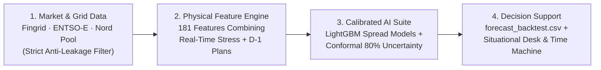
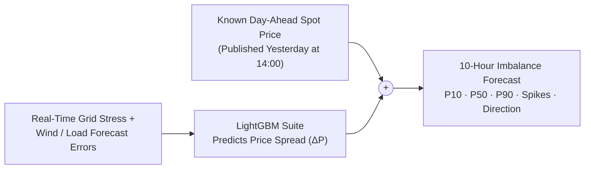
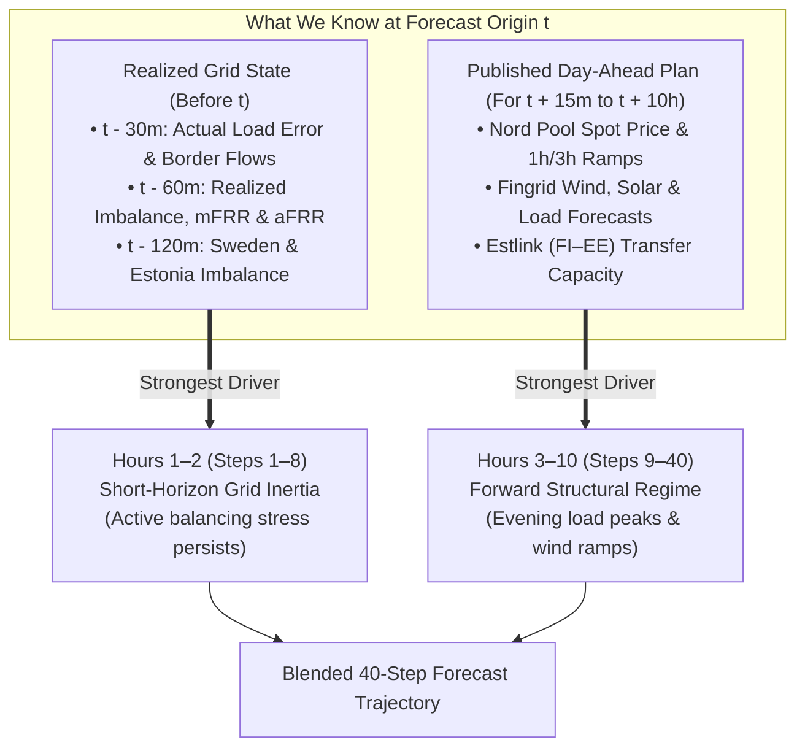
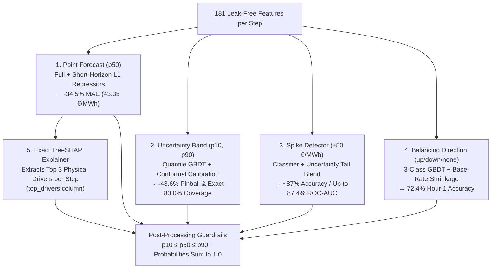
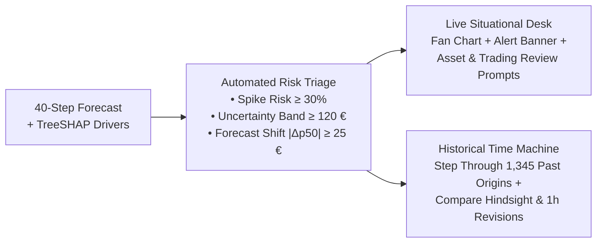

# High-Level Overview — Presentation-Ready Architecture & Functionality

This document provides clean, **slide-ready Mermaid diagrams** and concise explanations at a high level of abstraction. Every diagram is designed so it can be screenshotted or copied directly onto a presentation slide.

---

## 1. The Big Picture (4-Stage Pipeline)

At any hourly forecast origin $t$, our system transforms raw grid and market data into a calibrated 10-hour (40 quarter-hour) probabilistic forecast and actionable decision support in four steps:

| Stage | What It Does | Why It Matters |
| :--- | :--- | :--- |
| **1. Market & Grid Data** | Loads Fingrid, ENTSO-E, and Nord Pool time series and filters out anything published after origin $t$ (`first_usable_origin_utc <= t`). | Guarantees **100% zero future data leakage** (`Rule #1`). |
| **2. Physical Feature Engine** | Combines **what just happened on the grid** (last 30–120 min) with **what is scheduled for tomorrow** (known Day-Ahead spot price, wind, solar, and load). | Captures both short-term grid inertia and long-term supply/demand ramps. |
| **3. Calibrated AI Suite** | Predicts the price deviation ($\Delta P$) from the known spot price, calibrates the 80% uncertainty band (`P10–P90`), and explains the top 3 physical drivers via **TreeSHAP**. | Reduces error by **34.5% (MAE)** and **48.6% (Pinball)** while hitting **exact 80.0% coverage**. |
| **4. Decision Support** | Outputs the validated submission (`forecast_backtest.csv`) and powers the interactive **Level 2 Situational Desk & Historical Time Machine**. | Gives shift supervisors and traders early spike warnings and concrete review suggestions. |

---

## 2. Core Forecasting Idea: Predict the Spread ($\Delta P$), Not Raw Price

Under Finnish market rules, the day-ahead **Spot Price** is already locked in at 14:00 the day before, and whenever there is no dominant mFRR balancing need, the **Imbalance Price equals the Spot Price**. Instead of guessing raw prices from scratch, our model predicts how much the grid will **deviate** from the known spot price:

$$P_{\text{imbalance}}(t + k) = \underbrace{P_{\text{spot}}(t + k)}_{\text{Known since D-1 14:00}} + \underbrace{\Delta P(t + k)}_{\text{Predicted by AI}}$$

---

## 3. Bridging the 10-Hour Horizon (Two Physical Regimes)

A 10-hour forecast (40 steps of 15 minutes) spans two very different physical regimes. Our architecture blends specialized models for each:

- **Hours 1–2 (`Steps 1–8` — Grid Inertia):** Weather timing errors and plant outages persist for 1–2 hours. Dedicated **Short-Horizon Specialists** focus on the latest 30m consumption forecast error and 60m mFRR/aFRR activations.
- **Hours 3–10 (`Steps 9–40` — Forward Structure):** Real-time persistence fades. **Full-Horizon Models** rely on the known D-1 spot curve, residual load, and 3-hour wind ramps—beating the baseline by **40.1%** at Hour 10.

---

## 4. How the AI Model Suite Works Together

Instead of a single black-box model, five specialized modules produce a mathematically consistent, explainable forecast for every 15-minute step:

### Key Innovations in Plain Language
1. **Split Conformal Calibration (`p10`, `p90`):** Standard decision trees are overconfident (capturing only ~68% of actual prices). We scale the interval width using recent out-of-sample errors so **exactly 80.0%** of actual prices fall inside `[P10, P90]`.
2. **Uncertainty-Aware Spike Probabilities (`p_spike_high`, `p_spike_low`):** Combines a dedicated spike classifier with the width of our `P10–P90` interval—when uncertainty widens during a wind ramp, spike probability automatically rises.
3. **TreeSHAP Transparency (`top_drivers`):** Every single forecast row names the top 3 physical factors driving that specific quarter-hour (e.g., `day_ahead_spot_price;residual_load_forecast;wind_forecast_3h_ramp`).

---

## 5. Level 2 Situational Awareness Desk & Time Machine

The Level 2 Streamlit application (`apps/dashboard.py`) turns the 40-step forecast into an operational cockpit for **Production Shift Supervisors** and **Electricity Traders**:

| User Persona | What They See | Example Suggested Action to Review |
| :--- | :--- | :--- |
| **Production Shift Supervisor** *(Power plants, electric boilers, heat pumps)* | 10-hour P10–P50–P90 price fan chart, high/low spike alert banners, and dominant mFRR direction. | **High Up-Spike Risk (`>30%`):** Consider deferring flexible electric boiler / heat pump consumption or checking fast-start reserve readiness. **Low / Negative Price Risk:** Opportunity to absorb cheap surplus electricity in district heating boilers or thermal storage. |
| **Electricity Trading Specialist** *(Intraday & balancing markets)* | Hour-over-hour forecast revision deltas ($t - 1\text{h} \to t$), TreeSHAP drivers, and cross-border flow telemetry. | **Material Upward Revision (`Δp50 ≥ +25 €/MWh`):** Review intraday short exposure before gate closure as real-time Fingrid consumption error tightens the grid. |

---

## 6. Headline Results at a Glance (Slide Scorecard)

| Evaluation Criterion | Official Weight | Starter Baseline | Our Solution | Impact |
| :--- | :---: | ---: | ---: | :--- |
| **Point Accuracy (`p50` MAE)** | **30%** | 66.20 €/MWh | **43.35 €/MWh** | **-34.5% error** (**-40.1%** at Hour 10) |
| **Uncertainty (`p10`–`p90` Pinball)** | **20%** | 24.18 | **12.43** | **-48.6% pinball loss** |
| **P10–P90 Interval Coverage** | *(Target 80%)* | 68.29% | **80.00%** | **Exact 80.0% calibration target** |
| **Spike Identification (`±50 €` Brier)** | **20%** | 0.1132 | **0.0943** | **-16.6% Brier** (**~87% accuracy**) |
| **Balancing Direction (3-Class Brier)** | **10%** | 0.4509 | **0.4132** | **-8.4% Brier** (**72.4% Hour-1 accuracy**) |
