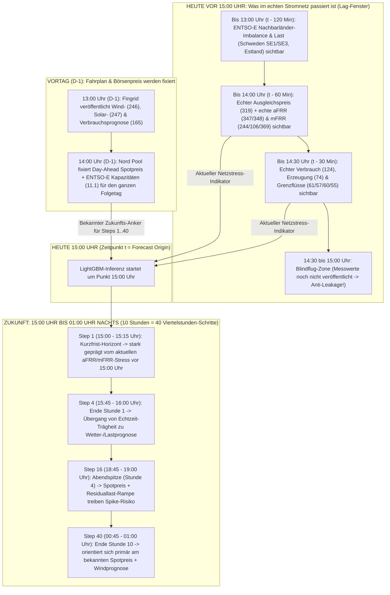
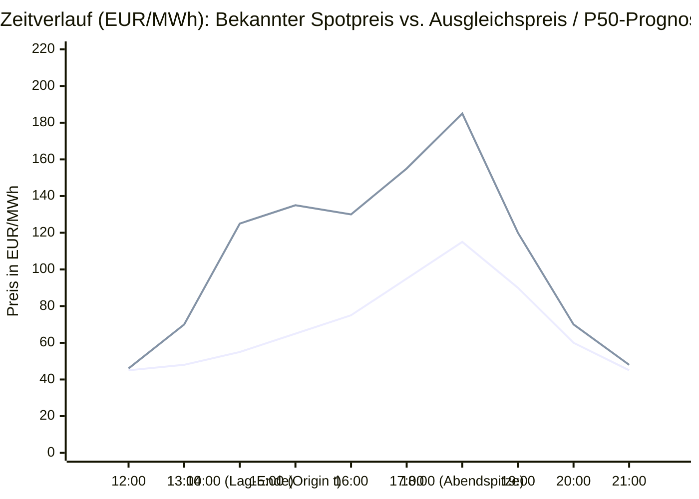
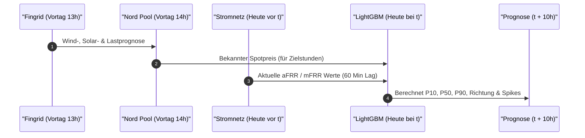
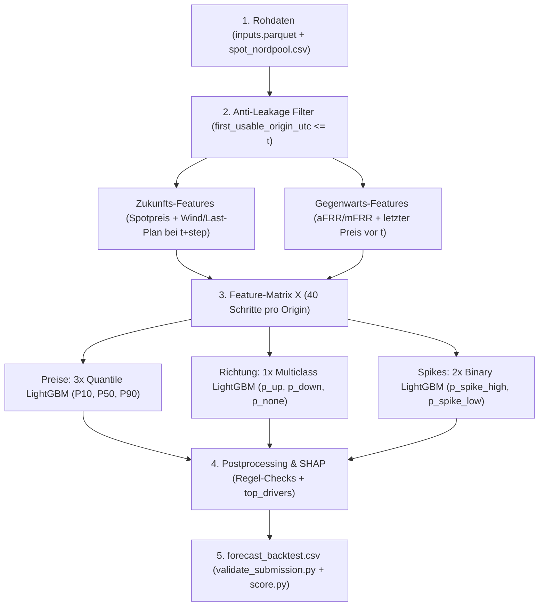

# ⚡ Turku Energia Imbalance Price Forecasting – Der komplette Leitfaden & Architektur-Guide

Dieser Guide fasst das gesamte **Turku Energia Imbalance Price Challenge**-Projekt (Since AI Hackathon 2026) zusammen – inklusive **visueller Zeitstrahl-Logik**, **System-Architektur**, **Zusammenhang zwischen Day-Ahead Spotpreis, aFRR/mFRR und unserer Prognose** sowie einer **Schritt-für-Schritt-Anleitung** für die Umsetzung im Code.

---

## 1. Das Wichtigste zuerst: Wie hängen Day-Ahead-Prognose, Spotpreis, aFRR/mFRR und unsere Prediction zusammen?

Hier liegt oft das größte Missverständnis. Deshalb klären wir zuerst die **zeitliche Kausalität**:

> [!IMPORTANT]
> **Wir müssen NICHT den Spotpreis vorhersagen!**
> Den **Day-Ahead Spotpreis** bekommen wir von der Strombörse Nord Pool **bereits am Vortag um 14:00 Uhr fertig geliefert** (`../data/spot_nordpool.csv`).
> Was wir vorhersagen müssen, ist der **Ausgleichsenergiepreis (`Imbalance Price`)** – also wie stark der echte Netzpreis in den nächsten 10 Stunden vom bereits bekannten Spotpreis nach oben oder unten abweichen wird!

### 🕒 Der exakte 24-Stunden-Zeitstrahl (vom Vortag bis zu unserer Prediction)

#### A. Chronologischer Zeitgraph (Alle Uhrzeiten & Lags im Detail)

Beispiel: Wir stehen **heute um 15:00 Uhr (`t`)** und sagen die Preise bis **01:00 Uhr nachts (`t + 10h`)** vorher:



#### B. Preis-Zeitgraph: Spotpreis vs. Echter Ausgleichspreis (durch aFRR/mFRR) vs. Unsere Prognose

Dieser Graph zeigt anschaulich am Beispiel eines Nachmittags (mit Windflaute ab 14:00 Uhr), wie **aFRR & mFRR** den Preis vor 15:00 Uhr nach oben treiben und wie unser Modell daraus den Verlauf für **15:00 bis 21:00 Uhr** vorhersagt:



* **12:00 Uhr:** Netz ist ausgeglichen (`mFRR = none`) $\rightarrow$ Ausgleichspreis ($46\text{ €}$) $\approx$ Spotpreis ($45\text{ €}$).
* **13:00 – 14:00 Uhr (vor $t$):** Weniger Wind als geplant! Fingrid aktiviert `aFRR Up` und `mFRR Up` $\rightarrow$ Echter Ausgleichspreis springt auf **$125\text{ €/MWh}$** (obwohl der Spotpreis nur bei $55\text{ €}$ lag!).
* **15:00 Uhr (unser Zeitpunkt $t$):** Unser Modell sieht den Sprung bis 14:00 Uhr **und** sieht, dass der bekannte Spotpreis bis 18:00 Uhr auf $115\text{ €}$ klettert. Es prognostiziert deshalb für 18:00 Uhr einen Ausgleichspreis von **$P_{50} = 185\text{ €/MWh}$** und schlägt Alarm (`p_spike_high > 0.60`, da $185\text{ €} > 115\text{ €} + 50\text{ €}$).
* **Ab 20:00 Uhr:** Wind nimmt laut Prognose wieder zu, Last sinkt $\rightarrow$ unsere $P_{50}$-Prognose nähert sich wieder dem bekannten Spotpreis ($48\text{ €} \approx 45\text{ €}$) an.



### 🔍 Was passiert in den einzelnen Schritten genau?

#### Schritt A: Vortag 13:00 Uhr & 14:00 Uhr – Der Plan wird gemacht (Zukunfts-Features!)
1. **Um 13:00 Uhr am Vortag (D-1)** veröffentlicht Fingrid die Day-Ahead-Prognosen für den gesamten nächsten Tag:
   * Wie viel Windstrom wird morgen je Viertelstunde erwartet? (`dataset 246`)
   * Wie viel Solarstrom wird erwartet? (`dataset 247`)
   * Wie hoch wird der Stromverbrauch sein? (`dataset 165`)
2. **Um 14:00 Uhr am Vortag (D-1)** bildet sich an der Börse Nord Pool daraus der **Spotpreis (`fi_spot_price`)** für jede einzelne Viertelstunde des nächsten Tages.
3. **Warum ist das für uns Gold wert?**
   Wenn unser Modell heute um z. B. **15:00 Uhr** (`forecast_origin_utc = t`) die nächsten **10 Stunden** (`15:00` bis `01:00` nachts, Schritte 1 bis 40) vorhersagen soll, **kennen wir den Spotpreis und die Wind-/Verbrauchsprognosen für diese zukünftigen 10 Stunden bereits!** Sie stehen für die Zukunft bereit, ohne gegen die `first_usable_origin_utc`-Regel zu verstoßen.

#### Schritt B: Warum weicht der Ausgleichspreis überhaupt vom Spotpreis ab?
Zwischen 14:00 Uhr gestern (als der Spotpreis festgelegt wurde) und heute passiert die echte Physik im Stromnetz:
* Es weht plötzlich **weniger Wind** als gestern um 13:00 Uhr gedacht, oder es ist **kälter** (Verbraucher heizen mehr), oder ein Kraftwerk fällt aus.
* Jetzt fehlt im finnischen Netz plötzlich Strom (Frequenz fällt unter 50 Hz).
* Fingrid muss sofort **Regelenergie (`aFRR` automatisch in Sekunden, `mFRR` manuell in Minuten)** hochfahren (**Up-Regulation**).
* Wer kurzfristig Kraftwerke hochfährt, verlangt hohe Preise (oft +100 bis +500 €/MWh über dem Spotpreis).
* Aus dem **volumengewichteten Durchschnitt** von `mFRR` und `aFRR` entsteht der **Ausgleichspreis (`Imbalance Price`)**.

#### Schritt C: Wie spielen `aFRR` und `mFRR` in unsere eigene Prediction hinein?
Da `aFRR` und `mFRR` erst in Echtzeit aktiviert werden, kennen wir zum Zeitpunkt $t$ natürlich noch **nicht** die zukünftigen `aFRR`- und `mFRR`-Volumina für $t+1$ bis $t+10$ Stunden (diese sind erst 60 Minuten *nach* der jeweiligen Viertelstunde bekannt!).

**Aber `aFRR` und `mFRR` helfen unserer Prediction auf zwei entscheidenden Wegen:**

1. **Als „Fieberthermometer“ für den aktuellen Netz-Zustand (Lag-Features aus den Stunden vor $t$):**
   * Zum Zeitpunkt $t$ kennen wir alle echten `aFRR`- und `mFRR`-Aktivierungen, Preise und Richtungen bis zu $t - 60\text{ Minuten}$ (und den echten Verbrauch/Grenzfluss bis $t - 30\text{ Minuten}$).
   * **Beispiel:** Wenn in den letzten 2 Stunden vor $t$ bereits durchgehend 400 MW `mFRR Up-Regulation` aktiviert werden mussten und die Differenz zwischen echtem Verbrauch (`124`) und geplanter Verbrauchsprognose (`165`) riesig ist, weiß das Modell: *„Das Netz hat gerade ein strukturelles Stromdefizit – der Wetterbericht lag heute falsch!“*
   * Da Wetterfronten und Kraftwerksausfälle mehrere Stunden anhalten (**Autokorrelation / Trägheit**), überträgt das Modell diesen aktuellen Stress aus `aFRR`/`mFRR` auf die kommenden Stunden (besonders stark für die Schritte 1 bis 16, also die ersten 4 Stunden).

2. **Als gelernte Muster für zukünftige Engpässe (für Schritte 1 bis 40):**
   * Im **Training** sieht LightGBM tausende historische Stunden und lernt:
     * *„Immer wenn für Stunde $t+k$ ein hoher Spotpreis + steiler Anstieg der Verbrauchsprognose (Abendspitze 17–19 Uhr) + wenig Wind prognostiziert ist UND in den Stunden vor $t$ schon `aFRR`/`mFRR` nach oben geregelt hat, schießt der Ausgleichspreis mit hoher Wahrscheinlichkeit um $>50\text{ €/MWh}$ über den Spotpreis (`p_spike_high`).“*

---

## 2. Übersicht aller Datenquellen & wann wir sie nutzen dürfen (`availability.csv`)

Diese Tabelle zeigt exakt, welche Daten im Ordner `../data` liegen und wann sie für eine Prognose zum Zeitpunkt $t$ (`forecast_origin_utc`) sichtbar sind:

| Datenquelle (`series_group`) | Fingrid / ENTSO-E ID | Wann verfügbar? (`first_usable_origin_utc`) | Rolle für unsere Prediction zum Zeitpunkt $t$ |
| :--- | :--- | :--- | :--- |
| **Kalender** (`calendar`) | Wochentag, Stunde, Feiertag | **Immer im Voraus bekannt** | **Zukunfts-Feature** für Zielstunde $t+\text{step}$ (Tageszeit- & Wochenend-Muster) |
| **Day-Ahead Prognosen** (`wind`, `solar`, `consumption_forecast_da`) | `246`, `247`, `165` | **Vortag 13:00 Uhr** (Finnische Zeit) | **Zukunfts-Feature** für Zielstunde $t+\text{step}$ (Geplante Einspeisung & Last) |
| **Day-Ahead Spotpreis** (`spot_price`) | `spot_nordpool.csv` | **Vortag 14:00 Uhr** (Finnische Zeit) | **Wichtigstes Zukunfts-Feature** (Ankerpreis für Zielstunde $t+\text{step}$) |
| **Übertragungskapazität** (`transfer_capacity`) | `11.1` (FI–EE) | **Vortag 14:00 Uhr** (Finnische Zeit) | **Zukunfts-Feature** (Wie viel Strom kann über Kabel importiert/exportiert werden?) |
| **Echter Verbrauch & Erzeugung** | `124`, `74` | **30 Min nach Viertelstunden-Ende** | **Gegenwarts-/Lag-Feature** (zeigt aktuelle Abweichung vom Day-Ahead-Plan!) |
| **Grenzüberschreitende Flüsse** (`cross_border_flow`) | `61`, `57`, `60`, `55` | **30 Min nach Viertelstunden-Ende** | **Gegenwarts-/Lag-Feature** (Aktueller Import/Export mit Schweden/Estland/Norwegen) |
| **Echter Ausgleichspreis** (`imbalance_price`) | `319` | **60 Min nach Viertelstunden-Ende** | **Zielvariable ($y$)** + **wichtigstes Lag-Feature** (letzter bekannter Preis bei $t$) |
| **mFRR Preis, Volumen & Richtung** | `244`, `106`, `375`, `376`, `369` | **60 Min nach Viertelstunden-Ende** | **Zielvariable (`direction`)** + **Lag-Feature** (aktueller Regelenergie-Stress) |
| **aFRR Preis & Volumen** | `347`, `348` | **60 Min nach Viertelstunden-Ende** | **Lag-Feature** (automatische Kurzfrist-Regelung der letzten Stunden vor $t$) |
| **Nachbarländer Imbalance/Last** | `17.1.g`, `6.1.b` | **120 Min nach Perioden-Ende** | **Lag-Feature** (Netzstress in Schweden SE1/SE3 und Estland) |

---

## 3. Visuelle Gesamt-Architektur (End-to-End Pipeline)



---

## 4. Unser smarter Trick für die Preisprognose: Den „Spread“ zum Spotpreis vorhersagen!

Anstatt das Modell blind den absoluten Ausgleichspreis schätzen zu lassen, hilft folgende Überlegung aus der Marktmechanik:

$$\text{Ausgleichspreis} = \text{Spotpreis} + \underbrace{(\text{Ausgleichspreis} - \text{Spotpreis})}_{\text{Imbalance Spread }\Delta P}$$

* Wenn im Netz **keine dominante Regelrichtung (`none`)** herrscht, ist $\Delta P = 0$, also $\text{Ausgleichspreis} = \text{Spotpreis}$.
* Wenn **Up-Regulation (`up`)** herrscht, ist $\Delta P \ge 0$ (Preis steigt über den Spotpreis).
* Wenn **Down-Regulation (`down`)** herrscht, ist $\Delta P \le 0$ (Preis fällt unter den Spotpreis).
* Auch die **Preisspitzen (`Spikes`)** sind in der Challenge exakt über diesen Spread definiert:
  * `spike_high = 1`, wenn $\Delta P > +50\text{ €/MWh}$
  * `spike_low = 1`, wenn $\Delta P < -50\text{ €/MWh}$

Daher ist der **Spotpreis der Ziel-Viertelstunde (`spot_at_delivery`)** (oder das direkte Trainieren auf den Spread $\Delta P$ und anschließendes Addieren des Spotpreises) der stärkste Hebel, um den **Baseline-MAE von 66,20 €/MWh** drastisch zu schlagen!

---

## 5. Schritt-für-Schritt-Kochbuch: Wie setzen wir das jetzt einfach um?

Unsere Projektstruktur ist bereits fertig vorbereitet:

```text
├── data/                      # Alle CSV- & Parquet-Daten (inkl. forecast_origins.csv, sample_submission.csv)
├── notebooks/
│   └── baseline.ipynb         # Offizielles Starter-Notebook (Referenz)
├── src/
│   ├── data/                  # Schritt 1: Daten laden & rows_available_at()
│   ├── features/              # Schritt 2: Feature-Matrix X bauen
│   ├── models/                # Schritt 3: Die 6 LightGBM-Modelle + SHAP
│   └── evaluation/            # Schritt 4: Postprocessing, validate_submission.py & score.py
├── apps/                      # Schritt 5: Level 2 Dashboard (Streamlit / UI)
├── score.py                   # Offizielles Scoring-Skript
└── validate_submission.py     # Offizielles Validierungs-Skript
```

### Schritt 1: Daten-Loader (`../src/data/loader.py`)
Lädt `../data/inputs.parquet` und `data/spot_nordpool.csv` und stellt `rows_available_at(data, origin_utc)` bereit, sodass niemals Zukunftsdaten durchsickern.

### Schritt 2: Feature-Builder (`../src/features/build_features.py`)
Erzeugt für jeden Prognosezeitpunkt $t$ (`forecast_origin_utc`) und jeden der 40 Schritte (`step = 1..40`, also `delivery_start_utc = t + (step-1)*15min`) eine Zeile in der Feature-Matrix $X$:
1. **Horizont-Feature:** `step` (1 bis 40).
2. **Zukunfts-Features am Zeitpunkt `delivery_start_utc`** *(sofern `first_usable_origin_utc <= t`)*:
   * `spot_price_target`: Bekannter Nord Pool Spotpreis für die Ziel-Viertelstunde.
   * `wind_forecast_target`, `solar_forecast_target`, `consumption_forecast_target`: Fingrid Day-Ahead-Prognosen für die Ziel-Viertelstunde.
   * `residual_load_forecast`: `consumption_forecast_target - wind_forecast_target - solar_forecast_target` (wie viel Last muss durch konventionelle Kraftwerke/Importe gedeckt werden?).
   * `hour_utc`, `dayofweek`, `is_weekend`: Kalender-Features der Ziel-Viertelstunde.
3. **Lag-/Echtzeit-Features am Zeitpunkt `t`** *(die letzten bekannten Werte vor `t`)*:
   * `last_imbalance_price`: Letzter bekannter Ausgleichspreis (60 Min vor $t$) sowie Mittelwert/Std/Min/Max der letzten 4 und 12 Viertelstunden.
   * `last_imbalance_spread`: Letzter bekannter Ausgleichspreis minus damaliger Spotpreis.
   * `last_mfrr_up_vol`, `last_mfrr_down_vol`, `last_mfrr_direction`: Wie stark musste Fingrid zuletzt manuell regeln?
   * `last_afrr_up_vol`, `last_afrr_down_vol`: Wie stark musste Fingrid zuletzt automatisch regeln?
   * `consumption_forecast_error`: Letzter echter Verbrauch (`124`, 30 Min vor $t$) minus prognostizierter Verbrauch (`165`) – zeigt sofort, ob die Verbrauchsprognose heute danebenliegt!
   * `net_cross_border_flow`: Summe der aktuellen Grenzflüsse (`61`, `57`, `60`, `55`).

### Schritt 3: Training der 6 LightGBM-Modelle (`../src/models/train.py`)
Wir trainieren die 6 Modelle mit `RANDOM_SEED = 42`:
* **Auf der Validierungsperiode testen:**
  * Training auf Daten vor dem **7. September 2026** (`2026-09-06T21:00:00Z`).
  * Vorhersage für die Validierungsperiode (**7. Sep – 4. Okt 2026**).
  * Bewertung mit `../score.py` gegen `data/actuals_validation.csv` (Vergleich mit Baseline: `MAE 66.20`, `Pinball 24.18`).
* **Für die finale Abgabe (`../forecast_backtest.csv`):**
  * Training auf allen Daten bis zum **4. Oktober 2026** (bzw. rollierendes Nachtrainieren).
  * Vorhersage für die **673 Test-Origins** (`5. Okt – 1. Nov 2026`, ergibt exakt **26.920 Zeilen**).

### Schritt 4: Postprocessing & Pflicht-Validierung
Vor dem Speichern von `../forecast_backtest.csv` werden die Regeln erzwungen und geprüft:

```bash
# 1. Format-Validierung (muss VALIDATION PASSED ergeben!)
./venv/bin/python validate_submission.py --backtest forecast_backtest.csv --origins data/forecast_origins.csv

# 2. Lokales Scoring auf den Validierungsdaten
./venv/bin/python score.py --submission baseline_output/validation/forecast_backtest.csv --actuals data/actuals_validation.csv --spike-margin 50 --output-dir results/validation
```

---

## 6. Kurz-Checkliste für das Team

- [x] **Python-Umgebung (`../venv`)** mit Python 3.12, `lightgbm`, `shap`, `pandas`, `numpy`, `scikit-learn`, `jupyter`, `streamlit`, `plotly` installiert.
- [x] **Datenstruktur (`../data`)** sauber konsolidiert und in `../.gitignore` vor versehentlichem Upload geschützt.
- [x] **Meilenstein 1 (Level 1 Pipeline):**
  1. `../src/data/loader.py` & `src/features/build_features.py` erstellt (181 Anti-Leakage Features).
  2. Die LightGBM-Modell-Suite (inkl. Short-Horizon Specialists, Split Conformal Quantile Calibration & Empirical Bayes Brier-Kalibrierung) in `../src/models/train.py` auf der Validierungsperiode trainiert (`MAE: 43.35 €/MWh` vs. Baseline `66.20 €/MWh`; `Pinball: 12.43` vs. Baseline `24.18`; `Spike Brier: 0.0943` vs. `0.1132`; `Direction Brier: 0.4132` vs. `0.4509`; `Coverage: 80.00%`).
  3. Valide `../forecast_backtest.csv` (26.920 Zeilen, `VALIDATION PASSED`) generiert.
- [x] **Meilenstein 2 (Level 2 Dashboard in `../apps/dashboard.py`):**
  1. Interaktives Dashboard mit Warn-Alerts bei `p_spike_high >= 0.3` / `p_spike_low >= 0.3` und Revisions-Tracking.
  2. „Time Machine“-Auswahl zum Durchklicken aller 673 Test- und 672 Validierungs-Origins inkl. `top_drivers` (TreeSHAP) und JSON-API-Export.
