# Turku Energia Imbalance Price Forecasting Challenge

**Since AI Hackathon 2026 (6–8 Nov 2026, Turku)** · Schema Version `1.0`

Welcome to the documentation hub for our end-to-end **10-hour (40 quarter-hour) probabilistic imbalance price forecasting** and **Level 2 Situational Awareness & Time Machine** solution for Turku Energia.

---

## System Overview (Mermaid Architecture)

```mermaid
flowchart LR
    subgraph DATA["1. Starter Package Data (first_usable_origin_utc <= t)"]
        D1["Fingrid Open Data (CC BY 4.0)<br/>Imbalance, mFRR/aFRR, Load & Wind/Solar DA"]
        D2["ENTSO-E Transparency (CC BY 4.0)<br/>SE1/SE3/EE Imbalance, Load & FI-EE Capacity"]
        D3["Nord Pool Day-Ahead Spot (Licensed)<br/>fi_spot_price (Published D-1 14:00 EET/EEST)"]
    end

    subgraph FEAT["2. Anti-Leakage FeatureStore (181 Features)"]
        F1["Target-Delivery Forward Features (38)<br/>Spot Price, Residual Load & 1h/3h Wind Ramps"]
        F2["Real-Time Grid Inertia Lags (96)<br/>30m Load Error/Flows & 60m Imbalance/mFRR/aFRR"]
        F3["Regional Contagion & Horizon Decay (47)<br/>120m SE1/SE3/EE Spreads + Diurnal/Calendar"]
    end

    subgraph MODEL["3. Calibrated LightGBM Suite + TreeSHAP"]
        M1["p50 Point Forecast<br/>Full + Short-Horizon L1 Spread Blend"]
        M2["p10 / p90 Quantiles<br/>Split Conformal Dispersion Scaling (80.0% Cov)"]
        M3["p_spike_high / p_spike_low<br/>GBDT Classifier + Parametric Tail Blend"]
        M4["p_up / p_down / p_none<br/>Multiclass GBDT + Empirical Bayes Shrinkage"]
        M5["Exact TreeSHAP Explainer<br/>Per-Row top_drivers Attribution"]
    end

    subgraph OUT["4. Deliverables & Decision Support"]
        O1["forecast_backtest.csv<br/>26,920 Rows (673 Origins × 40 Steps)"]
        O2["Level 2 Streamlit Dashboard<br/>Situational Alerts & Historical Time Machine"]
    end

    DATA --> FEAT --> MODEL --> OUT
```



---

## Validation Benchmark Summary (`7 Sep – 4 Oct 2026`)

| Criterion | Weight | Official Baseline | Our Solution | Improvement |
| :--- | :---: | ---: | ---: | ---: |
| **MAE on `p50` (EUR/MWh)** | **30% of L1** | 66.2033 | **43.3463** | **-34.53%** (`-22.86 EUR/MWh`) |
| **Mean Pinball Loss (`p10`, `p90`)** | **20% of L1** | 24.1776 | **12.4336** | **-48.57%** |
| **Empirical P10–P90 Coverage** *(target 80%)* | — | 68.29% | **80.00%** | **Exact 80.0% target** |
| **Mean Brier Score, Spikes (`±50 EUR`)** | **20% of L1** | 0.1132 | **0.0943** | **-16.64%** |
| **3-Class Brier Score, Direction** | **10% of L1** | 0.4509 | **0.4132** | **-8.36%** |

---

## Documentation Sections

- **[System Architecture](ARCHITECTURE.md)** — Visual Mermaid topology of all layers (`src/data`, `src/features`, `src/models`, `src/evaluation`, `apps/dashboard.py`, `tests/`) and how each component works.
- **[Evaluation Report](EVALUATION_REPORT.md)** — Reasoning chain, physical market mechanics, anti-leakage proof, 181-feature engineering & TreeSHAP gains, calibration methodology, and horizon-by-horizon validation metrics.
- **[Architecture & Timeline Guide](PROJECT_GUIDE.md)** — Detailed 24-hour causality timeline (D-1 spot/forecasts vs. 30m/60m/120m lag windows), Mermaid sequence/flowchart diagrams, and step-by-step system walkthrough.
- **[Data Sources, Models & Licenses](DATA_MODELS_LICENSES.md)** — Complete inventory of datasets, publication lag rules, custom LightGBM models, open-source software packages, and Nord Pool licensing governance.
- **[Official Challenge Brief](CHALLENGE_BRIEF.md)** — Original Turku Energia & Since AI 2026 challenge specification, evaluation criteria, and glossary.

---

## Quick Commands

```bash
# Serve this documentation locally with live reload (http://127.0.0.1:8000)
./venv/bin/mkdocs serve

# Build static HTML documentation into ./site
./venv/bin/mkdocs build

# Run full Level 1 training, validation scoring & submission pipeline
./venv/bin/python -m src.evaluation.pipeline

# Launch Level 2 Situational Awareness & Time Machine Dashboard
./venv/bin/streamlit run apps/dashboard.py

# Run all 17 automated pytest checks + official submission validator
./scripts/run_checks.sh
```
